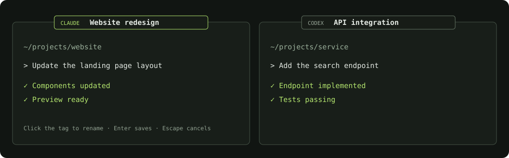

# Agent Window Titles for Omarchy

[](https://github.com/marselnenaj/omarchy-agent-titles/actions/workflows/ci.yml)
[](LICENSE)

See which Claude or Codex terminal belongs to which task. A small, persistent
tag follows each agent window. Click the tag to rename it in place.



The preview is an illustration using example names, not a desktop screenshot.

## Features

- Automatic labels from the terminal's existing chat or project title.
- Click to rename; Enter saves, Escape cancels, clicking outside saves.
- Clear a custom name and press Enter to return to the automatic title.
- Labels follow windows between monitors and workspaces.
- Labels hide on real fullscreen workspaces and behind overlapping floating windows.
- Colors follow the Omarchy theme, with optional appearance overrides.
- No network requests, telemetry, chat-history access or agent API keys.

## Requirements

This plugin needs **Omarchy Shell with its Quickshell plugin system** and
Hyprland. Older Omarchy installations using Waybar do not provide this plugin
host. Confirm that `omarchy plugin --help` and `omarchy-shell shell ping` work.

Runtime dependencies are supplied by a compatible Omarchy installation:
Quickshell's Hyprland and Wayland modules, and the shell's `qs.Commons` module.
The plugin has been exercised with Ghostty on Hyprland 0.56.2. It recognizes
Alacritty, Kitty, Foot and WezTerm classes too; those terminals have not all
been tested interactively.

## Install

Use Omarchy's plugin manager:

```sh
omarchy plugin add https://github.com/marselnenaj/omarchy-agent-titles.git --enable
```

The plugin ID is `io.github.marselnenaj.agent-titles`. Installation does not
change Hyprland rules or terminal settings.

```sh
# Update
omarchy plugin update io.github.marselnenaj.agent-titles

# Disable / enable
omarchy plugin disable io.github.marselnenaj.agent-titles
omarchy plugin enable io.github.marselnenaj.agent-titles

# Uninstall; personal name settings remain in the file described below
omarchy plugin remove io.github.marselnenaj.agent-titles
```

If you already have a manually installed copy under this ID, disable it and
move its directory out of `~/.config/omarchy/plugins/` before using `plugin add`.
Keep `agent-titles.json` to preserve existing window names.

For local development, `bash install.sh` copies only the runtime files into a
user plugin directory, backs up an existing manual installation, and enables
the plugin. It requires Bash, jq and standard GNU utilities. It deliberately
refuses to overwrite a git-managed installation; use the plugin manager there.

## Rename a window

1. Click the title tag above an agent terminal.
2. Type a name.
3. Press **Enter** to save or **Escape** to cancel.

Names belong to the current window, persist across shell reloads, and reset
for a new terminal window or compositor session. The plugin does not rename
the underlying Claude/Codex conversation or alter the terminal's OSC title.

## Appearance

Settings are stored in
`$XDG_CONFIG_HOME/omarchy/agent-titles.json`, defaulting to
`~/.config/omarchy/agent-titles.json`. Changes reload automatically. The file
is created when you first save a custom name.

Merge these keys into your existing file. **Preserve `names`** if you want to
keep your custom names. [The example file](examples/agent-titles.example.json)
contains only generic appearance settings and is not installed automatically.

| Key | Default | Accepted values |
| --- | --- | --- |
| `fontSize` | `14` | 10–24 pixels |
| `maxWidth` | `960` | 160–1600 pixels |
| `offsetY` | `0` | −80 to 80 pixels; positive moves down |
| `background` | Theme background | `#RRGGBB` |
| `foreground` | Theme foreground | `#RRGGBB` |
| `accent` | Theme accent | `#RRGGBB` |

The default 24-pixel tag straddles the upper window edge and ends 14 pixels
inside the terminal. This matches Omarchy's usual terminal padding. If your
terminal has less top padding, adjust `offsetY` or increase its padding.
Larger fonts extend further above the window, so they need more window gap.

## Privacy and behavior

The plugin reads Hyprland's window titles, geometry and workspace state. It
uses those titles only to draw the labels; it does not read chat databases,
terminal contents, environment secrets or agent credentials. Custom names are
saved locally in `agent-titles.json`. There is no diagnostic IPC endpoint that
exports window titles or the text being edited.

Do not attach your personal settings, terminal screenshots or shell config to
an issue without checking them for private project names or other sensitive
information. The repository contains only source, synthetic test fixtures and
the illustrated preview.

## Limitations and troubleshooting

- A normal shell is not labelled. Detection uses dedicated agent app classes,
  agent names, common Claude/Codex title markers and Codex's idle
  `task | directory` format. Recognized windows retain their agent hint between
  activity frames; returning to a shell/path title clears the hint. Unrecognized
  custom title formats may still need a dedicated agent app class.
- Position changes are refreshed five times per second through Quickshell's
  shared Hyprland model; dragging can show a brief delay. No polling processes
  are spawned. Unchanged snapshots and activity-spinner frames retain the same
  presentation objects, so they do not republish the label layout state.
  Monitor refreshes are event-driven and coalesced rather than polled.
- Changes to terminal padding, overlapping tiled layouts and unusual compositor
  animations can require placement adjustments.
- The editor uses a separate keyboard-capable Wayland surface over the same
  tag. Hovering does not open a tooltip or take keyboard focus.
- After changing plugin code, use `omarchy-shell shell rescanPlugins`. If an
  older QML component remains cached, disable/enable the plugin or restart the
  shell with `omarchy restart shell` when convenient.

## Development

The running UI uses the existing Omarchy Qt/Quickshell process. Python, Node.js
and shell scripts below are development/installation tools, not background
processes for the labels. Changing application language alone does not remove
the compositor's geometry-query requirement. Native compositor decorations
such as Hyprbars have a different integration model and can follow window
geometry directly; this plugin remains an independently hosted overlay.

Node.js 24+ and Python 3 are used only for the development checks; there are no
npm dependencies or runtime Node processes.

```sh
node --test tests/*.test.cjs
python3 scripts/check-publication.py
bash -n install.sh scripts/scan-secrets.sh
omarchy plugin validate .  # Run on an Omarchy machine
```

CI runs the model/settings checks, package checks, ShellCheck and a Gitleaks
history scan. Actions and the scanner archive are pinned to immutable
commits/checksums. See [CONTRIBUTING.md](CONTRIBUTING.md) for the manual UI checks.

## License

[MIT](LICENSE). Independently developed; not affiliated with Anthropic or OpenAI.
